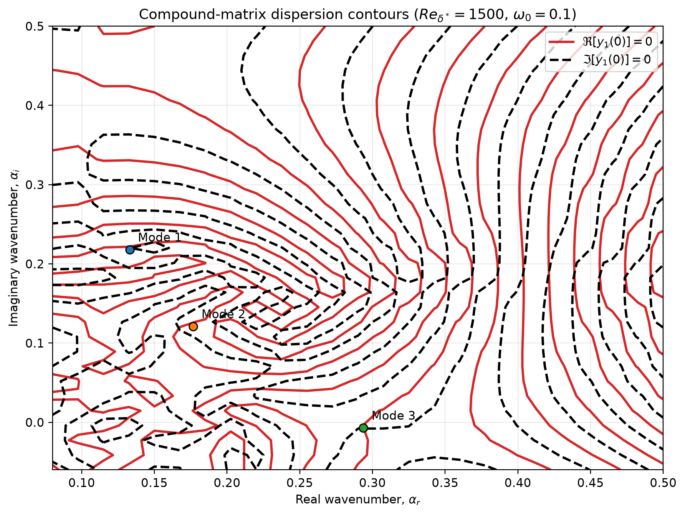

## 6. Generated figures

The plots below are generated by `python run_study.py` and are displayed directly in this README.

### Dispersion zero contours

### Scaled dispersion magnitude

### Blasius base flow

### Spatial growth and decay

## 7. PDF report

The numerical report is available directly in this repository:

[**Open or download REPORT.pdf**](REPORT.pdf)

The PDF contains the governing equation, compound-matrix IVP, far-field initial conditions, reference eigenvalues, and generated figures.

# Assignment 02 — Orr–Sommerfeld Spatial Stability

**Student:** Pratyush Singh Parmar  
**Roll No.:** 24JE0314  
**Institute:** IIT (ISM) Dhanbad

This project calculates the spatial eigenvalues of the two-dimensional Orr–Sommerfeld equation for a Blasius boundary layer. It uses the **Compound Matrix Method (CMM)** to convert the fourth-order boundary-value problem into a six-equation initial-value problem (IVP).

The code computes the Blasius base flow, applies analytical conditions at the free-stream boundary, integrates the compound system towards the wall, searches the complex wavenumber plane, and plots the results.

---

## 1. Problem and parameters

For spatial instability analysis, the Reynolds number and circular frequency are real. The streamwise wavenumber is complex:

$$
\alpha = \alpha_r + i\alpha_i
$$

The two-dimensional Orr–Sommerfeld equation is

$$
(D^2-\alpha^2)^2\phi =
i\widetilde{Re}
\left[
(\alpha U-\omega_0)(D^2-\alpha^2)\phi
-\alpha U''\phi
\right]
$$

where:

- $D = d/d\widetilde{y}$ is differentiation with respect to the wall-normal coordinate.
- $\widetilde{y} = y/\delta^*$ is the displacement-thickness coordinate.
- $U(\widetilde{y})$ is the Blasius streamwise velocity, normalized by the free-stream velocity.
- $\widetilde{Re}$ is the Reynolds number based on displacement thickness.
- $\omega_0$ is the non-dimensional circular frequency.

The free-stream decay parameter is

$$
Q = \sqrt{\alpha^2+i\widetilde{Re}(\alpha-\omega_0)},
\qquad \mathrm{Re}(Q)>0
$$

The square-root branch is selected so that the disturbance modes decay in the free stream.

## 2. Compound Matrix Method

The six compound variables are the $2\times2$ minors formed from the two decaying fundamental solutions. They satisfy the following first-order IVP:

$$
\begin{aligned}
\frac{dy_1}{d\widetilde{y}} &= y_2, \\
\frac{dy_2}{d\widetilde{y}} &= y_3+y_4, \\
\frac{dy_3}{d\widetilde{y}} &= b_1y_2+y_5, \\
\frac{dy_4}{d\widetilde{y}} &= y_5, \\
\frac{dy_5}{d\widetilde{y}} &= y_6+b_1y_4+b_2y_1, \\
\frac{dy_6}{d\widetilde{y}} &= b_2y_2.
\end{aligned}
$$

The coefficients are

$$
b_1 = 2\alpha^2+i\widetilde{Re}(\alpha U-\omega_0)
$$

$$
b_2 = \alpha^4+i\widetilde{Re}\alpha U''
+i\widetilde{Re}\alpha^2(\alpha U-\omega_0)
$$

### Initial conditions at the free stream

At the truncated free-stream location $\widetilde{y}=\widetilde{y}_{\max}$, the scaled initial values are

$$
\begin{aligned}
y_1 &= \alpha-Q, \\
y_2 &= Q^2-\alpha^2, \\
y_3 &= \alpha^3-Q^3, \\
y_4 &= \alpha^2Q-\alpha Q^2, \\
y_5 &= \alpha Q^3-\alpha^3Q, \\
y_6 &= \alpha^3Q^2-\alpha^2Q^3.
\end{aligned}
$$

The IVP is integrated **backwards from the free stream to the wall**.

### Wall dispersion relation

The wall boundary conditions require the dispersion function to vanish:

$$
\boxed{
\widehat{D}(\alpha,\omega_0,\widetilde{Re})
= y_1(0;\alpha,\omega_0,\widetilde{Re}) = 0
}
$$

The roots of this complex equation are found by locating the intersection of the contours

$$
\mathrm{Re}(y_1(0))=0
\qquad \text{and} \qquad
\operatorname{Im}(y_1(0))=0
$$

in the $(\alpha_r,\alpha_i)$ plane.

## 3. Numerical procedure

1. **Blasius base flow:** solve the similarity equation
   $$
   f'''+\frac{1}{2}ff''=0,
   \qquad f(0)=f'(0)=0,\quad f'(\infty)=1.
   $$
   The displacement-thickness factor is evaluated numerically, and the velocity profile is expressed in $\widetilde{y}=y/\delta^*$ coordinates.

2. **Far-field initialisation:** calculate $Q$, $b_1$, $b_2$, and the six analytical compound initial values.

3. **IVP integration:** integrate the six coupled equations backwards using classical fourth-order Runge–Kutta (RK4). The six-component state is commonly rescaled during integration to control overflow; this does not change the zero of the dispersion function.

4. **Complex-plane search:** evaluate the real and imaginary parts of $y_1(0)$ on a grid in the $(\alpha_r,\alpha_i)$ plane. Refine candidate intersections using a bounded nonlinear solver.

5. **Plots and output:** save the dispersion contours, dispersion magnitude, Blasius base-flow profile, spatial growth indicator, and computed eigenvalues.

## 4. Reference case and results

The lecture notes provide the reference case:

| Parameter | Value |
|---|---:|
| $\widetilde{Re}$ | 1500 |
| $\omega_0$ | 0.1 |

The computation uses $\widetilde{y}_{\max}=12$ as the finite free-stream boundary.

The three reference eigenvalues are:

| Mode | $\alpha_r$ | $\alpha_i$ | Spatial behaviour |
|---:|---:|---:|---|
| 1 | 0.13301166 | 0.21791206 | Decay |
| 2 | 0.17675903 | 0.12104523 | Decay |
| 3 | 0.29373736 | -0.00703999 | Growth |

The corresponding wall-dispersion residual magnitudes in **results.csv** are approximately $2.171\times10^{-11}$, $4.579\times10^{-15}$, and $4.878\times10^{-10}$.

For the spatial convention used in the lecture notes:

- $\alpha_i < 0$: disturbance grows downstream (spatially unstable).
- $\alpha_i > 0$: disturbance decays downstream (spatially stable).

The values above closely reproduce the reference table in the supplied Orr–Sommerfeld notes. Small differences in the final digits arise from numerical integration and root-refinement tolerances.

## 5. Repository structure

~~~text
Assignment_02_24JE0314/
├── README.md
├── requirements.txt
├── run_study.py                 # Run the grid search and generate outputs
├── generate_figures.py          # Regenerate plots from saved grid data
├── build_report.py              # Build REPORT.pdf
├── results.csv                  # Refined eigenvalues and wall residuals
├── methods/
│   ├── blasius.py               # Blasius similarity profile
│   ├── compound_matrix.py       # Six-equation CMM initial-value solver
│   └── root_finding.py          # Grid search and root refinement
├── tests/
│   └── test_compound_matrix.py  # Numerical regression tests
├── report/
│   └── report.md                # Technical report
└── .github/workflows/
    └── tests.yml                # GitHub Actions tests
~~~

The **figures/** directory and **dispersion_grid.npz** are generated when the study is run locally.

## 6. How to run

Python 3.10 or newer is recommended.

~~~bash
# Clone the repository
git clone https://github.com/parthpratyush/Assignment_02_24JE0314.git
cd Assignment_02_24JE0314

# Create and activate a virtual environment
python3 -m venv .venv
source .venv/bin/activate

# Install dependencies
pip install -r requirements.txt

# Run the numerical study and generate plots
python run_study.py

# Build the PDF report
python build_report.py

# Run the regression tests
pytest -q
~~~

### Change the input parameters

For example, to run the reference case with a different search range:

~~~bash
python run_study.py --re 1500 --omega0 0.1 --y-max 12 --alpha-r-min 0.08 --alpha-r-max 0.50 --alpha-i-min -0.06 --alpha-i-max 0.50
~~~

## 7. Notes and assumptions

- This is the **two-dimensional spatial stability problem**: $\alpha$ is complex, while $\omega_0$ and $\widetilde{Re}$ are real.
- The lecture notes do not provide a tabulated Blasius velocity profile. The code therefore computes the classical Blasius similarity solution and converts it to displacement-thickness coordinates.
- The infinite free-stream boundary is truncated at $\widetilde{y}_{\max}=12$ for the reference run. This is a numerical approximation; increase **--y-max** to investigate domain sensitivity.
- The compound system is homogeneous. Common non-zero rescaling of its six-component state prevents overflow without changing the location of dispersion-function zeros.
- The Orr–Sommerfeld equation, compound coefficients, initial conditions, and wall dispersion relation follow the supplied *Orr-Sommerfeld Equation* notes, particularly the 2-D equation and CMM derivation (PDF pages 7–18).

## 8. Author

**Pratyush Singh Parmar**  
**Roll No.:** 24JE0314  
**IIT (ISM) Dhanbad
