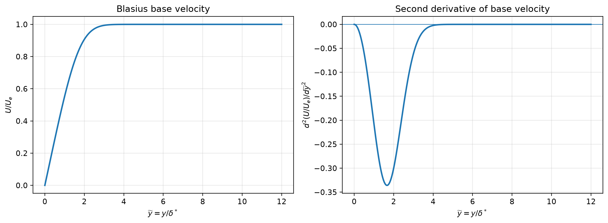

# Assignment 02 — Orr–Sommerfeld Spatial Stability

**Student:** Pratyush Singh Parmar  
**Roll No.:** 24JE0314  
**Institute:** IIT (ISM) Dhanbad

Numerical solution of the two-dimensional Orr–Sommerfeld equation for spatial stability of a Blasius boundary layer using the **Compound Matrix Method (CMM)**.

The fourth-order Orr–Sommerfeld boundary-value problem is transformed into a six-equation initial-value problem. The program computes the Blasius base flow, imposes the analytical decaying-mode initial conditions at the free stream, integrates towards the wall, searches the complex wavenumber plane, and generates figures and a PDF report.

<strong>Quick links</strong>

- [Numerical report (PDF)](REPORT.pdf)
- [Technical report source](report/report.md)
- [Reference numerical results](results.csv)
- [Main solver](run_study.py)
- [Compound-matrix implementation](methods/compound_matrix.py)
- [Regression tests](tests/test_compound_matrix.py)

---

## 1. Governing equation

For spatial instability analysis, the Reynolds number and circular frequency are real, while the streamwise wavenumber is complex:

$$
\alpha = \alpha_r + i\alpha_i
$$

The two-dimensional Orr–Sommerfeld equation is

$$
(D^2-\alpha^2)^2\phi =
i\widetilde{Re}
\left[
(\alpha U-\omega_0)(D^2-\alpha^2)\phi
-\alpha U''\phi
\right]
$$

where $D=d/d\widetilde{y}$, $\widetilde{y}=y/\delta^*$, and $U(\widetilde{y})$ is the dimensionless Blasius streamwise velocity.

The free-stream decay parameter is

$$
Q = \sqrt{\alpha^2+i\widetilde{Re}(\alpha-\omega_0)},
\qquad \mathrm{Re}(Q)>0
$$

## 2. Compound Matrix Method

The six compound variables are the $2\times2$ minors formed from the two decaying fundamental solutions. They satisfy

$$
\begin{aligned}
\frac{dy_1}{d\widetilde{y}} &= y_2, \\
\frac{dy_2}{d\widetilde{y}} &= y_3+y_4, \\
\frac{dy_3}{d\widetilde{y}} &= b_1y_2+y_5, \\
\frac{dy_4}{d\widetilde{y}} &= y_5, \\
\frac{dy_5}{d\widetilde{y}} &= y_6+b_1y_4+b_2y_1, \\
\frac{dy_6}{d\widetilde{y}} &= b_2y_2.
\end{aligned}
$$

The coefficients are

$$
b_1=2\alpha^2+i\widetilde{Re}(\alpha U-\omega_0)
$$

$$
b_2=\alpha^4+i\widetilde{Re}\alpha U''
+i\widetilde{Re}\alpha^2(\alpha U-\omega_0)
$$

### Far-field initial conditions

At $\widetilde{y}=\widetilde{y}_{\max}$, the scaled initial values are

$$
\begin{aligned}
y_1 &= \alpha-Q, &
y_2 &= Q^2-\alpha^2, \\
y_3 &= \alpha^3-Q^3, &
y_4 &= \alpha^2Q-\alpha Q^2, \\
y_5 &= \alpha Q^3-\alpha^3Q, &
y_6 &= \alpha^3Q^2-\alpha^2Q^3.
\end{aligned}
$$

The six equations are integrated backwards from the free stream to the wall.

### Wall dispersion relation

The wall boundary conditions lead to the dispersion relation

$$
\widehat{D}(\alpha,\omega_0,\widetilde{Re})
=y_1(0;\alpha,\omega_0,\widetilde{Re})=0
$$

The roots are located from the intersection of the zero contours of $\mathrm{Re}(y_1(0))$ and $\mathrm{Im}(y_1(0))$ in the $(\alpha_r,\alpha_i)$ plane.

## 3. Numerical procedure

1. **Blasius base flow:** solve $f'''+\frac{1}{2}ff''=0$, with $f(0)=f'(0)=0$ and $f'(\infty)=1$. Convert the computed profile to displacement-thickness coordinates.
2. **Far-field initialisation:** calculate $Q$ and the six analytical compound initial values.
3. **IVP integration:** integrate the six coupled equations backwards using classical fourth-order Runge–Kutta (RK4). A common non-zero rescaling controls overflow without changing the zero of the dispersion function.
4. **Complex-plane search:** evaluate the real and imaginary parts of $y_1(0)$ on a grid in the $(\alpha_r,\alpha_i)$ plane. Refine candidate intersections with a bounded nonlinear solver.
5. **Post-processing:** generate the dispersion contours, dispersion magnitude, base-flow plots, spatial growth indicator, and numerical results table.

## 4. Reference case and results

The supplied lecture notes give the reference parameters $\widetilde{Re}=1500$ and $\omega_0=0.1$. The numerical calculation uses $\widetilde{y}_{\max}=12$.

| Mode | $\alpha_r$ | $\alpha_i$ | Spatial behaviour |
|---:|---:|---:|---|
| 1 | 0.13301166 | 0.21791206 | Decay |
| 2 | 0.17675903 | 0.12104523 | Decay |
| 3 | 0.29373736 | -0.00703999 | Growth |

The wall-dispersion residual magnitudes are approximately $2.171\times10^{-11}$, $4.579\times10^{-15}$, and $4.878\times10^{-10}$, respectively.

For the spatial convention used in the lecture notes:

- $\alpha_i<0$: disturbance grows downstream (spatially unstable).
- $\alpha_i>0$: disturbance decays downstream (spatially stable).

The computed values closely reproduce the three reference modes in the supplied Orr–Sommerfeld notes.

## 5. Generated figures

The following figures are generated by the numerical code and are embedded below.

### Dispersion zero contours

### Scaled dispersion magnitude

### Blasius base flow

### Spatial growth and decay

## 6. PDF report

The full submission report is included in the repository:

**[Open or download the Orr–Sommerfeld project report (PDF)](REPORT.pdf)**

The PDF presents the governing equation, compound-matrix system, far-field initial conditions, numerical method, reference eigenvalues, and generated plots.

## 7. Repository structure

~~~text
Assignment_02_24JE0314/
├── README.md
├── REPORT.pdf
├── requirements.txt
├── run_study.py
├── generate_figures.py
├── build_report.py
├── results.csv
├── dispersion_grid.npz
├── methods/
│   ├── blasius.py
│   ├── compound_matrix.py
│   └── root_finding.py
├── tests/
│   └── test_compound_matrix.py
├── report/
│   └── report.md
├── figures/
│   ├── dispersion_contours.png
│   ├── dispersion_magnitude.png
│   ├── blasius_base_flow.png
│   └── spatial_growth_indicator.png
└── .github/workflows/
    ├── tests.yml
    └── build-artifacts.yml
~~~

## 8. How to run

Python 3.10 or newer is recommended.

~~~bash
# Clone the repository
git clone https://github.com/parthpratyush/Assignment_02_24JE0314.git
cd Assignment_02_24JE0314

# Create and activate a virtual environment
python3 -m venv .venv
source .venv/bin/activate

# Install dependencies
pip install -r requirements.txt

# Run the numerical study and generate plots
python run_study.py

# Build the PDF report
python build_report.py

# Run regression tests
pytest -q
~~~

Input parameters can be changed from the command line, for example:

~~~bash
python run_study.py --re 1500 --omega0 0.1 --y-max 12 --alpha-r-min 0.08 --alpha-r-max 0.50 --alpha-i-min -0.06 --alpha-i-max 0.50
~~~

## 9. Notes and assumptions

- This project solves the **two-dimensional spatial stability problem**: $\alpha$ is complex, while $\omega_0$ and $\widetilde{Re}$ are real.
- The supplied notes do not contain a tabulated Blasius velocity profile. The code computes the classical Blasius similarity solution and converts it to displacement-thickness coordinates.
- The infinite free-stream boundary is truncated at $\widetilde{y}_{\max}=12$ for the reference run. Increase the input --y-max to investigate domain sensitivity.
- The compound system is homogeneous. Common non-zero rescaling of its six-component state prevents overflow without changing the location of dispersion-function zeros.
- The governing equation, compound coefficients, initial conditions, and wall dispersion relation follow the supplied *Orr–Sommerfeld Equation* notes, especially the 2-D equation and CMM derivation (PDF pages 7–18).

## Author

**Pratyush Singh Parmar**  
**Roll No.:** 24JE0314  
**IIT (ISM) Dhanbad
