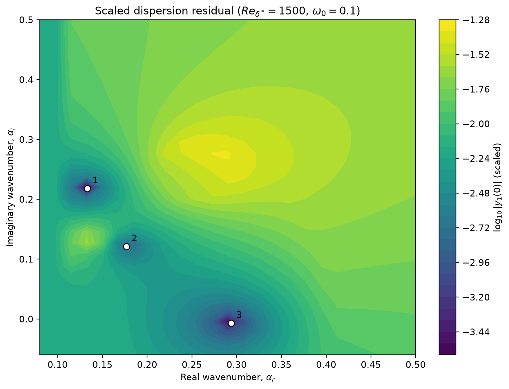
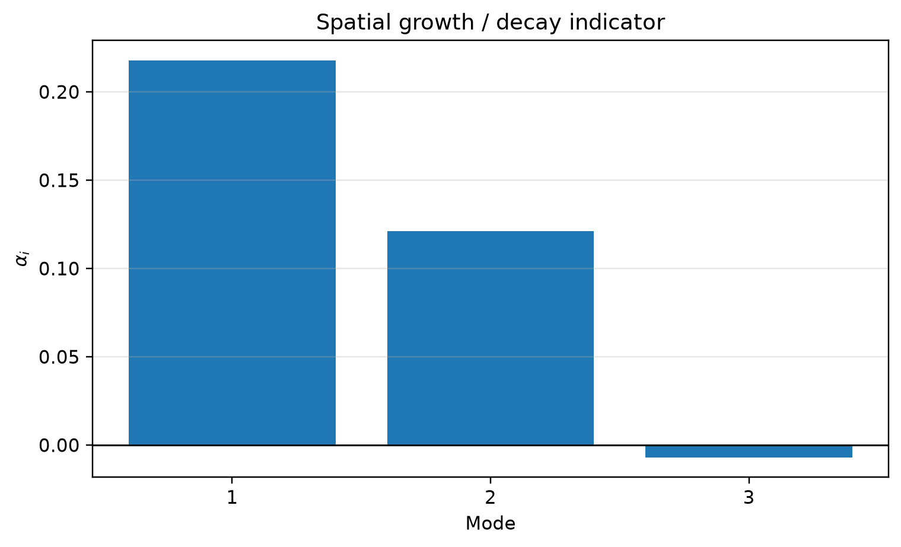

# Assignment 02 - Orr-Sommerfeld Spatial Stability using the Compound Matrix Method

**Student:** Pratyush Singh Parmar  
**Roll No.:** 24JE0314  
**Institute:** IIT (ISM) Dhanbad

This repository computes spatial eigenvalues of the two-dimensional Orr-Sommerfeld equation for a Blasius boundary layer. The fourth-order Orr-Sommerfeld equation is converted into the six-equation compound-matrix initial-value problem from the supplied lecture notes. The code integrates the prescribed far-field initial conditions toward the wall, evaluates the wall dispersion function, searches the complex wavenumber plane, and generates plots.

## 1. Problem statement

For spatial instability analysis, the circular frequency `omega0` and Reynolds number `Re_delta_star` are real, while the streamwise wavenumber is complex:

\[
\alpha = \alpha_r + i\alpha_i.
\]

The two-dimensional Orr-Sommerfeld equation used here is

\[
(D^2-\alpha^2)^2\phi = i\widetilde{Re}\left[(\alpha U-\omega_0)(D^2-\alpha^2)\phi-\alpha U''\phi\right],
\]

where `D = d/d(y_tilde)`, `y_tilde = y/delta_star`, and `U` is the dimensionless Blasius streamwise velocity.

The far-field decay rate is

\[
Q=\sqrt{\alpha^2+i\widetilde{Re}(\alpha-\omega_0)},\qquad \Re(Q)>0.
\]

The six compound variables are the 2-by-2 minors of the two decaying fundamental solutions. They satisfy

\[
\begin{aligned}
y_1'&=y_2, & y_2'&=y_3+y_4,\\
y_3'&=b_1y_2+y_5, & y_4'&=y_5,\\
y_5'&=y_6+b_1y_4+b_2y_1, & y_6'&=b_2y_2,
\end{aligned}
\]

with

\[
b_1=2\alpha^2+i\widetilde{Re}(\alpha U-\omega_0),
\]

\[
b_2=\alpha^4+i\widetilde{Re}\alpha U''+i\widetilde{Re}\alpha^2(\alpha U-\omega_0).
\]

The scaled far-field initial conditions at `y_tilde = y_max` are

\[
\begin{aligned}
y_1&=\alpha-Q, & y_2&=Q^2-\alpha^2,\\
y_3&=\alpha^3-Q^3, & y_4&=\alpha^2Q-\alpha Q^2,\\
y_5&=\alpha Q^3-\alpha^3Q, & y_6&=\alpha^3Q^2-\alpha^2Q^3.
\end{aligned}
\]

The wall boundary conditions are satisfied when the dispersion relation vanishes:

\[
\boxed{\;y_1(0;\alpha,\omega_0,\widetilde{Re})=0\;}.
\]

## 2. Numerical approach

1. **Blasius base flow:** solve `f''' + 0.5*f*f'' = 0` with `f(0)=f'(0)=0` and `f'(infinity)=1`. The displacement-thickness factor is evaluated numerically, and the profile is expressed in `y_tilde = y/delta_star`.
2. **Compound system:** calculate `Q` and the six analytical initial values at the truncated free-stream boundary `y_max`.
3. **IVP integration:** integrate the six coupled equations backward from `y_max` to the wall using classical fourth-order Runge-Kutta. The state is divided by its infinity norm after each step; this common positive rescaling prevents overflow and preserves the zero of the wall dispersion function.
4. **Complex-plane search:** evaluate the real and imaginary parts of `y1(0)` over an `(alpha_r, alpha_i)` grid. Local minima of `|y1(0)|` seed a bounded nonlinear refinement.
5. **Plots and results:** save the zero-contour intersection plot, scaled dispersion magnitude, Blasius profile, spatial growth indicator, and a CSV of the refined modes.

## 3. Reference case and numerical results

The reference case printed in the supplied notes is `Re_delta_star = 1500` and `omega0 = 0.1`. The numerical search in this repository uses `y_max = 12` and a finite complex-alpha search box. The root values below are reproduced to the displayed precision:

| Mode | `alpha_r` | `alpha_i` | Spatial behaviour |
|---:|---:|---:|---|
| 1 | 0.13301166 | 0.21791206 | Decays (`alpha_i > 0`) |
| 2 | 0.17675903 | 0.12104523 | Decays (`alpha_i > 0`) |
| 3 | 0.29373736 | -0.00703999 | Grows (`alpha_i < 0`) |

The source notes report approximately `(0.13301162, 0.21791196)`, `(0.17675906, 0.12104521)`, and `(0.29373724, -0.00703994)`. Small differences in the last digits arise from the finite integration step and the root refinement tolerance.

For the spatial convention used in the notes, `alpha_i < 0` indicates downstream growth and `alpha_i > 0` indicates downstream decay.

## 4. Repository structure

```text
Assignment_02_24JE0314/
├── README.md
├── requirements.txt
├── run_study.py                 # main grid search + output generation
├── generate_figures.py          # regenerate figures from saved grid data
├── build_report.py              # create REPORT.pdf from numerical outputs
├── results.csv                  # refined eigenvalues
├── dispersion_grid.npz          # saved complex-plane grid
├── methods/
│   ├── __init__.py
│   ├── blasius.py               # Blasius similarity profile
│   ├── compound_matrix.py       # six-equation CMM IVP
│   └── root_finding.py          # grid search + root refinement
├── tests/
│   └── test_compound_matrix.py  # checks against reference eigenvalues
├── report/
│   └── report.md                # technical write-up
├── figures/                     # generated PNG and SVG plots
└── .github/workflows/
    └── tests.yml                # automated regression test
```

## 5. Run the project

Python 3.10 or newer is recommended.

```bash
# 1. Clone the repository
 git clone https://github.com/parthpratyush/Assignment_02_24JE0314.git
 cd Assignment_02_24JE0314

# 2. Install dependencies
 python3 -m venv .venv
 source .venv/bin/activate
 pip install -r requirements.txt

# 3. Run the default reference case
 python run_study.py

# 4. Build the submission report
 python build_report.py

# 5. Run regression checks
 pytest -q
```

The default run uses `Re_delta_star = 1500`, `omega0 = 0.1`, and `y_max = 12`. Parameters and the search domain can be changed from the command line:

```bash
python run_study.py --re 1500 --omega0 0.1 --y-max 12 \
  --alpha-r-min 0.08 --alpha-r-max 0.50 \
  --alpha-i-min -0.06 --alpha-i-max 0.50
```

## 6. Generated figures

### Dispersion contours


### Scaled dispersion magnitude



### Blasius base flow


### Spatial growth / decay indicator



## 7. Notes and assumptions

- This implementation solves the **2-D spatial** problem: `alpha` is complex and `omega0` is real. It does not claim to solve the temporal or three-dimensional problem.
- The uploaded notes prescribe the Blasius profile but do not provide a tabulated `U(y_tilde)` array. The code therefore computes the classical Blasius similarity solution and converts it to displacement-thickness coordinates.
- The free stream at infinity is truncated at `y_max = 12`. This is a numerical approximation; increase `--y-max` to study domain sensitivity.
- The dispersion values are rescaled during integration to avoid overflow. Their zero contours and eigenvalue locations are invariant under this common nonzero scaling; the plotted magnitude is therefore labelled **scaled**.
- The CMM initial conditions, coefficients, first-order system, and wall dispersion condition follow the equations in the supplied *Orr-Sommerfeld Equation* notes (2-D Orr-Sommerfeld equation and CMM section, pp. 7-18 of the uploaded PDF).

## 8. Author

**Pratyush Singh Parmar**  
Roll No.: **24JE0314**  
IIT (ISM) Dhanbad